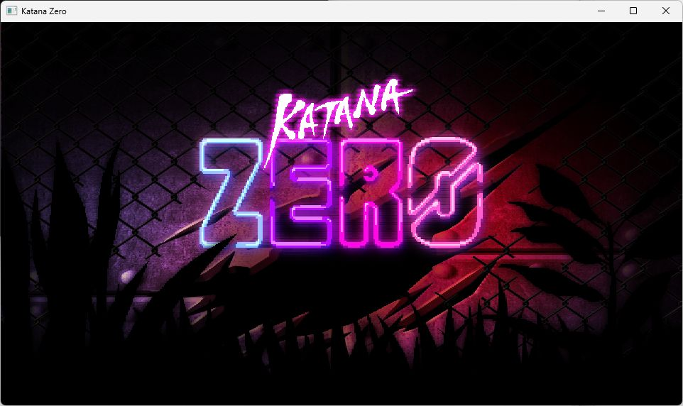
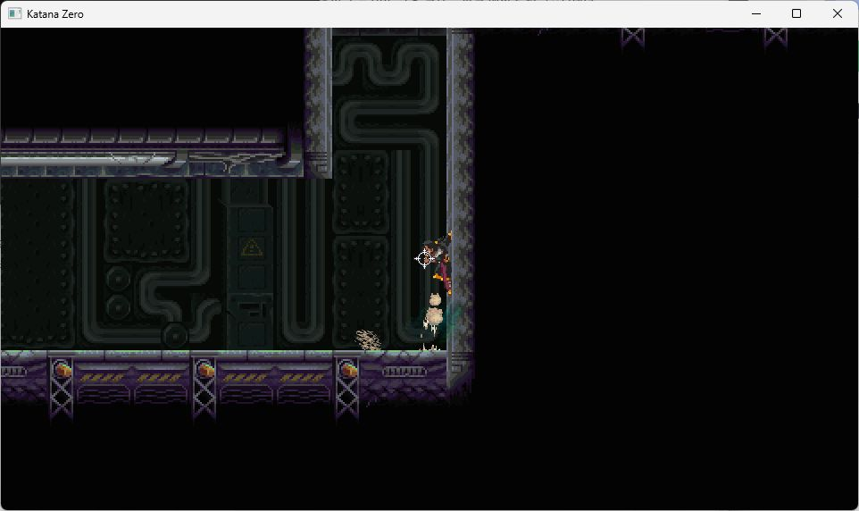

# Katana Zero | SFML Project

SFML 3.1과 C++로 제작한 《Katana Zero》 모작입니다. 2D 액션 전투, 슬로 모션과 되감기, JSON 맵으로 구성한 3개 스테이지를 구현했습니다.

## 플레이 화면

Windows Release x64 빌드에서 캡처한 타이틀과 첫 스테이지입니다. 타이틀에서 `Enter`를 누르면 게임이 시작됩니다.

| 타이틀 | 스테이지 1 |
| --- | --- |
|  |  |

## 프로젝트 개요

| 항목 | 내용 |
| --- | --- |
| 장르 | 2D 액션 플랫포머 |
| 언어·라이브러리 | C++17, SFML 3.1.0, nlohmann/json |
| 개발 도구 | Visual Studio 2022, MSVC v143 |
| 실행 환경 | Windows x64 |
| 구성 | 타이틀, 스테이지 1–3 |

## 주요 구현

- **플레이어 이동과 전투** — 상태 머신으로 달리기, 점프, 구르기, 벽 타기와 공격을 전환합니다. 마우스 방향으로 베며, 베기 판정이 적의 탄환에 닿으면 탄환을 반사합니다.
- **적 AI** — 근접형 Grunt와 총기를 사용하는 Gangster의 탐지, 추적, 공격과 피격 반응을 상태별로 처리합니다.
- **슬로 모션과 되감기** — 슬로 모션에서는 게임 진행 속도와 사운드 피치를 낮춥니다. 되감기에서는 플레이어와 적의 위치, 속도, 애니메이션 상태를 기록한 스냅샷에서 복원합니다.
- **맵 로딩과 충돌** — JSON에서 스테이지별 충돌 영역과 오브젝트 배치를 읽습니다. 경사면, 통과형 발판, 문, 스테이지 전환 지점을 처리합니다.
- **렌더링과 연출** — 배경, 캐릭터와 이펙트를 별도 렌더 타깃에 그린 뒤 셰이더로 합성합니다. 타이틀 애니메이션, 네온 글로우, 잔류 연막과 장면 전환 페이드를 구현했습니다.

## 조작

| 입력 | 동작 |
| --- | --- |
| `Enter` | 타이틀에서 게임 시작 |
| `A` / `D` | 좌우 이동 |
| `W` | 점프 |
| `S` | 앉기 또는 통과형 발판 내려가기 |
| 이동 중 `S` | 구르기 |
| 마우스 왼쪽 클릭 | 조준 방향으로 검 공격 |
| 왼쪽 `Shift` | 누르는 동안 슬로 모션 |
| `R` | 되감기 |

## 빌드 및 실행

1. Visual Studio 2022에 **C++를 사용한 데스크톱 개발** 워크로드를 설치합니다.
2. MSVC x64용 **SFML 3.1.0**을 `C:\SFML-3.1.0`에 배치하고, nlohmann/json의 단일 헤더 `json.hpp`를 `C:\SFML-3.1.0\include`에 넣습니다. SFML을 다른 경로에 설치했다면 프로젝트 속성에서 포함 디렉터리와 라이브러리 디렉터리를 수정합니다.
3. [SFML_Project.sln](SFML_Project.sln)을 열고 **Release | x64**로 빌드합니다.
4. `C:\SFML-3.1.0\bin`의 Release용 `sfml-*-3.dll`과 [프로젝트 폴더](SFML_Project)의 `*.frag` 파일 및 `resource` 폴더를 `x64\Release`에 복사합니다.
5. `x64\Release`에서 `SFML_Project.exe`를 실행합니다. 실행 위치를 바꿀 때는 EXE, DLL, 셰이더와 `resource`가 들어 있는 폴더 전체를 옮깁니다.
